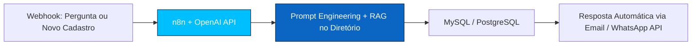

  

  
  
  

> **Rio de Janeiro - RJ | Remoto | Engenharia de Software - Estácio - Conclusão Out/2028 (elegível Jul/27 a Jan/29)**
> Marinha do Brasil - Analista de Suporte de Sistemas | Infra & Backend | Mar/2022 - Atual

---

### ⚡ Como eu construo - AI First, igual ao Toqan do iFood

Eu não faço landing page. Eu construo ferramenta interna deployada que tira operação da planilha.

É assim que estou evoluindo meus projetos: **construção e integração de soluções voltadas para produto de IA + operação de sistemas que sustentam ecossistema** - as duas vertentes da trilha AI Engineer.

---

### 🧰 O que eu já uso hoje - marcado no formulário GenAI

  
  
  

**Backend & IA:** Python, PHP, Node.js, OpenAI API, FastAPI, REST APIs, PDO, PHPMailer  
**Frontend:** JavaScript, React, HTML/CSS, Express  
**Dados & Infra:** MySQL, PostgreSQL, SQLite, Linux Debian, LAMP, DHCP, DNS, iptables, Samba 4, Squid, FTP, IredMail, Git

4 anos garantindo 99% de uptime em servidores Debian na Marinha. Backend PHP integrando APIs de Email/WhatsApp + ticketing.

---

### 📦 3 projetos que o recrutador vai abrir e validar

#### 1. Barra Space Center - Site institucional + Painel com RBAC
**Problema:** Gestão de empresas condôminas em planilha, site desatualizado, sem diretório dinâmico  
**Solução:** Portal único com diretório público (busca, ordenação, filtros, visibilidade ativa) + painel admin com RBAC: gerência, operador, padrão  
**O que tem no código:** `index.php, login.html, admin.php, novo_condomino.php, salvar_condomino.php, editar.php, atualizar_condomino.php, excluir.php, autenticar.php, auth.php, alterar_senha.php, criar_usuario.php, logout.php, conexao.php, banco.sql, migrations/, imagens/hero/ e convencoes/, style.css, admin.css, cursor.js, composer.json, .htaccess` - CRUD completo, hash de senha, validação server-side, PDO parametrizado  
`PHP | MySQL | PDO | RBAC | Composer | PHPMailer`

#### 2. Banca de Chopp - Sistema de Comandas / Portal Interno
**Problema:** Controle de vendas, estoque e pedidos em feira feito manual  
**Solução:** Sistema de comanda digital com dashboard interno que automatiza horas reais de operação  
**Resultado:** Ferramenta interna deployada, não protótipo - é o tipo de projeto que o iFood classifica como "automações que economizaram horas reais"  
`React | Node.js | SQLite | REST API | Git`

#### 3. Site TF Soluções Tecnológicas
**Problema:** Cliente precisava de presença institucional com contato seguro  
**Solução:** Site institucional + formulário com validação server-side e envio SMTP seguro  
`PHP | MySQL | HTML/CSS/JS | PHPMailer | Composer`

---

### 🎖️ O que me diferencia para o GenAI - sem inventar

- **Elegível:** 4º semestre, conclusão Out/2028 - dentro da janela Jul/27 a Jan/29 do edital
- **Operação crítica:** 4a5m na Marinha administrando Linux Debian/LAMP com 99% uptime - experiência real com sustentação de ecossistema
- **Disciplina operacional:** 1º Lugar no Curso de Formação de Fuzileiros Navais - aplicado no código
- **Projetos reais via TF Soluções:** Sistemas de gestão, dashboards e automações para clientes, não exercícios de curso
- **Formação em IA:** Formação Completa em IA 2026 (LLMs, IA Generativa, Agentes, RAG), LGPD, Cisco Cybersecurity, Automação de Sistemas IFRS, Servidores Linux Debian, Liderança IFRS

**Extracurricular que marquei como "Outros" no formulário:** EAD + Marinha + Projetos Full Stack com automação real + 1º Lugar CFN + 4 anos em ambiente crítico

---

### 📫 Contato

Estou em processo para o Estágio GenAI iFood - Trilha AI Engineer. Aberto para conversar sobre construção de agentes, automação e portais internos.

**LinkedIn:** pedro-henrique-costa-0a8648260 | **Email:** pedro274.phh@gmail.com | **GitHub:** Pedro274-ctrl

  

